# Lainamääkärit – PDF E-kirjasto

**Lainamääkärit** on Pythonilla ja Djangolla toteutettu responsiivinen ja helppokäyttöinen verkko-e-kirjasto PDF-kirjojen selaamiseen, lainaamiseen ja arvostelemiseen sekä tietokoneella että mobiililaitteilla.

---

## Keskeiset ominaisuudet

- **Responsiivinen käyttöliittymä ja 4 kontrastiteemaa**: Kaikki näkymät perivät `base.html`-pohjan, skaalautuvat kapeillekin mobiilinäytöille ja tukevat neljää teema-/kontrastitilaa (`Vaalea`, `Tumma`, `Korkea kontrasti (vaalea)`, `Korkea kontrasti (tumma)`), joiden valinta tallennetaan selaimen `localStorage`-muistiin puhtaalla vanilla JavaScriptillä.
- **Käyttäjähallinta**: Djangon vakiokirjautuminen ja -uloskirjautuminen sekä oma rekisteröitymislomake PBKDF2-salatuilla salasanoilla.
- **Salatut PDF-alkuperäisteokset ja väliaikainen lainaus**: Alkuperäiset PDF-tiedostot säilytetään salattuina (`SHAKE-256` + `HMAC-SHA256`) `library/encrypted/`-kansiossa. Kun käyttäjä lainaa kirjan, hänelle muodostetaan väliaikainen salaamaton PDF-kopio ja yksityinen lainalinkki kolmeksi vuorokaudeksi (tai kunnes laina palautetaan). Laina-ajan päättyessä salaamaton kopio poistetaan automaattisesti.
- **Kirjojen haku ja selaus**: Haku nimen, tekijän, avainsanan, kategorian, kielen, kuvauksen ja julkaisuvuoden perusteella sekä suodatus saatavuuden ja kategorian mukaan.
- **Arvostelut ja tähtiarvosanat (1–5 ★)**: Kirjautunut käyttäjä voi arvostella kunkin kirjan kerran ja muokata omaa arvosteluaan jälkikäteen. Kirjan lainaussivulla näytetään tähtiarvosanojen mediaani ja keskiarvo.
- **Huolto-ylläpitopaneeli (`/huolto/`)**: Ylläpitäjät voivat muokata lainoja tai päättää niitä ennenaikaisesti, piilottaa kirjoja valikoimasta tai palauttaa niitä näkyviin sekä seurata uusien kommenttien syötettä luontipäiväsuodattimella ja poistaa arvosteluja.

---

## Pika-aloitus ja käyttöönotto

Projektissa on valmiiksi määritetty virtuaaliympäristö `.venv` (Python 3.12, Django, Pillow sekä Playwright testausta varten) ja tietokantana toimii SQLite3 (`db.sqlite3`).

### 1. Tietokannan alustus ja esimerkkidatan lataus

```bash
# Suorita tietokantamigraatiot
.venv/bin/python manage.py migrate

# Salaa esimerkkikirjat library/encrypted/-kansioon ja populoi tietokanta idempotentisti
.venv/bin/python manage.py populate_db
```

> **Huom:** `populate_db` (tai suoraan `./populate_db.py`) on täysin idempotentti – se ei lisää duplikaatteja eikä ylikirjoita olemassa olevaa tietoa, jos tiedot löytyvät jo tietokannasta. Pelkkien PDF-esimerkkikirjojen synkronointiin voi käyttää myös komentoa `.venv/bin/python manage.py sync_library`.

### 2. Kehityspalvelimen käynnistäminen (oletusportti 8000)

```bash
.venv/bin/python manage.py runserver
```

Avaa selaimessa osoite: `http://127.0.0.1:8000/`

### 3. Lainausajan tilat (tuotanto / manuaalitestaus / automaattitestaus)

Oletuksena laina on voimassa **3 vuorokautta**. Voit vaihtaa laina-aikaa ympäristömuuttujilla testausta varten:

```bash
# Manuaalinen testaus (3 minuuttia):
DJANGO_LOAN_MODE=manual .venv/bin/python manage.py runserver

# Automaattinen testaus (2 sekuntia):
DJANGO_LOAN_MODE=test .venv/bin/python manage.py runserver

# Mielivaltainen kesto sekunteina (esim. 30 sekuntia):
DJANGO_LOAN_DURATION_SECONDS=30 .venv/bin/python manage.py runserver
```

### 4. Paikallinen tiedostopalvelinskripti (`serve_folder.sh`)

Juurikansiossa oleva skripti `serve_folder.sh` käynnistää paikallisen HTTP-palvelimen nykyiseen kansioon oletusportissa **8002**, sallii kaikkien alikansioiden selaamisen oletuksena ja varmistaa palvelimen toiminnan `curl`-komennolla:

```bash
# Käynnistys oletusportissa 8002:
./serve_folder.sh

# Käynnistys omassa portissa (esim. 8080):
./serve_folder.sh 8080
# tai:
./serve_folder.sh --port 8080
```

---

## Valmiit esimerkkikäyttäjät (`populate_db`)

| Käyttäjänimi | Salasana | Rooli |
| :--- | :--- | :--- |
| `aino_korhonen` | `AinoKirjasto2026!` | Ylläpitäjä (`Huolto`-käyttöoikeus) |
| `mikko_virtanen` | `MikkoLukija2026!` | Lukija (aktiivinen esimerkkilaina) |
| `sari_makinen` | `SariLukija2026!` | Lukija (aktiivinen esimerkkilaina) |
| `pekka_nieminen` | `PekkaLukija2026!` | Lukija |
| `laura_heikkinen` | `LauraLukija2026!` | Lukija |

---

## Tietokantarakenne

Järjestelmä käyttää neljää ydintaulua: Djangon autentikaatiotaulua (`auth_user`) sekä sovelluksen tauluja `kirjat` (`Kirja`), `kommentit` (`Kommentti`) ja `lainat` (`Laina`).

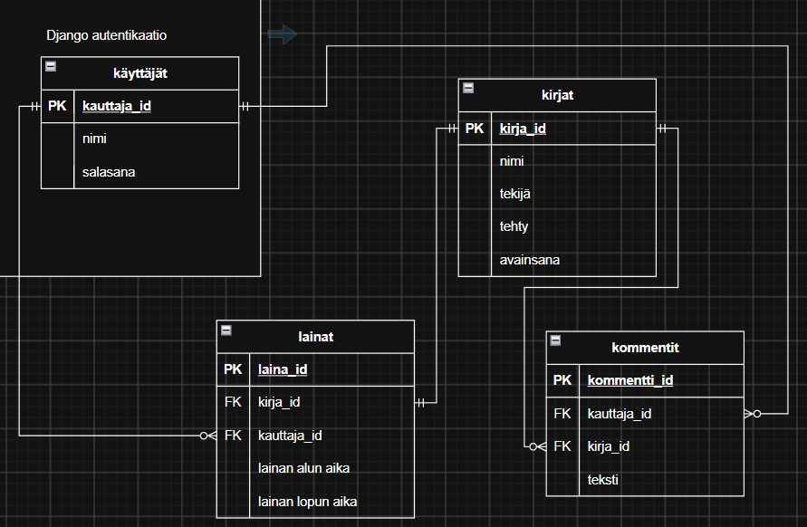

---

## Käyttöopas ja kuvakaappaukset

### Etusivu ja kirjautuminen

Etusivu näyttää kirjaston vapaiden teosten määrän. Kirjautumattomalle käyttäjälle tarjotaan painikkeet kirjautumiseen ja rekisteröitymiseen; kirjautuneelle käyttäjälle näytetään omat voimassa olevat lainat, suorat PDF-avauslinkit sekä uloskirjautumispainike.

#### Etusivu (kirjautumaton ja kirjautunut käyttäjä)

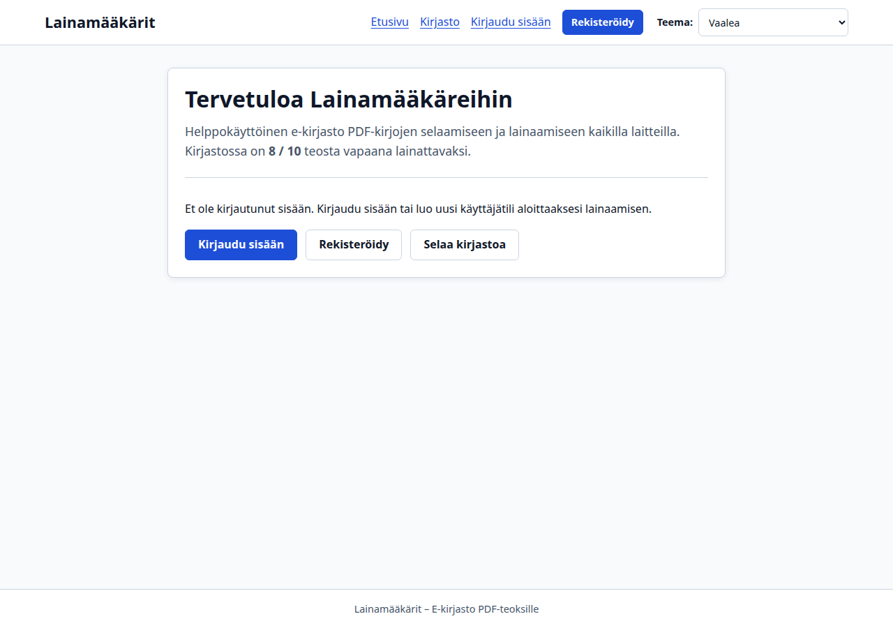

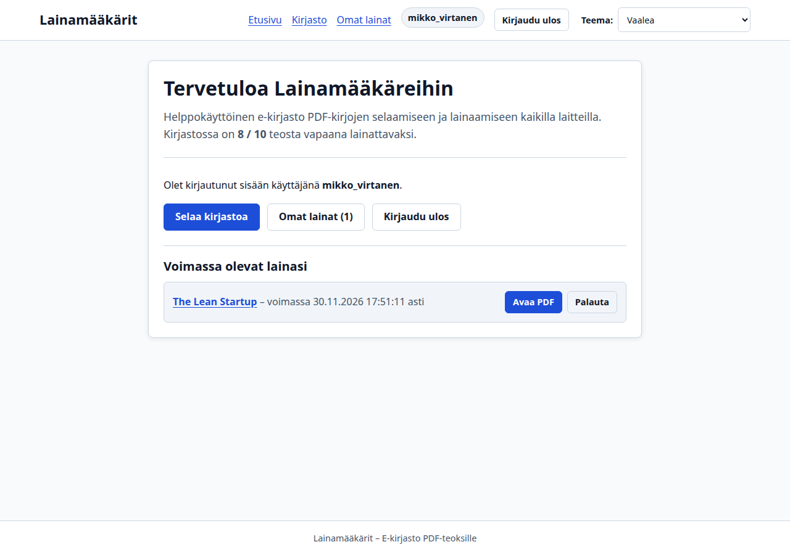

#### Kirjautuminen ja uuden tilin rekisteröinti

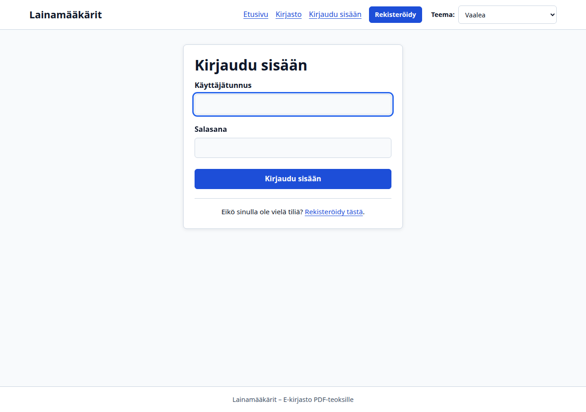

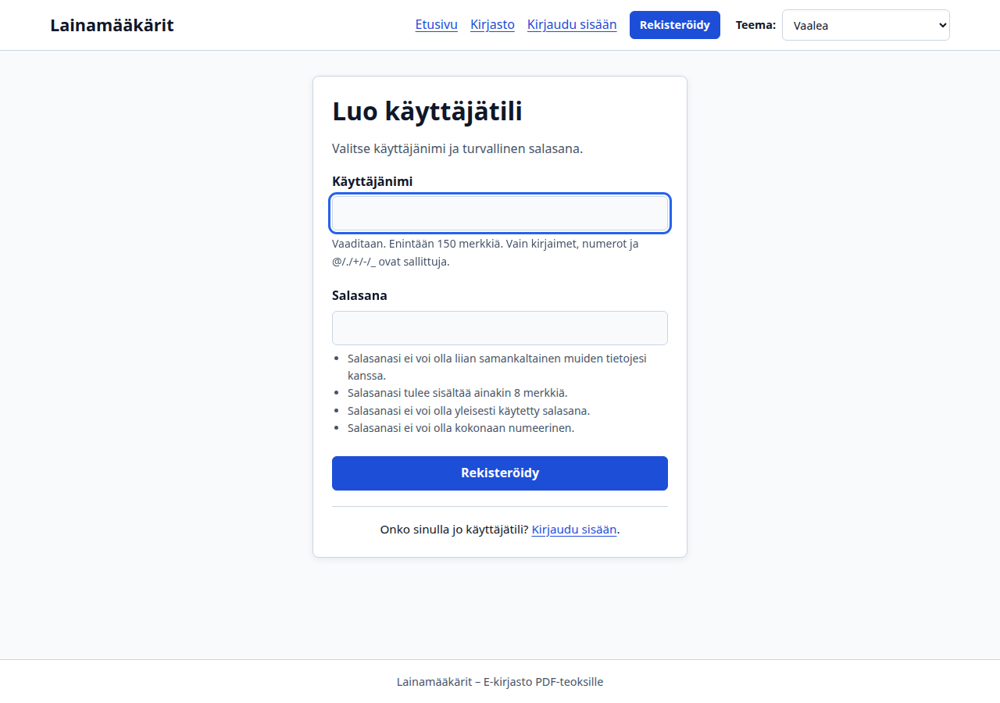

---

### E-kirjasto ja neljä teema-/kontrastitilaa

Yläpalkin **Teema**-valikosta käyttäjä voi vaihtaa vaalean, tumman, korkean kontrastin vaalean sekä korkean kontrastin tumman tilan välillä. Asetus tallennetaan selaimeen (`localStorage`), joten se säilyy sivulatausten välillä.

#### Vaalea teema (`light`)

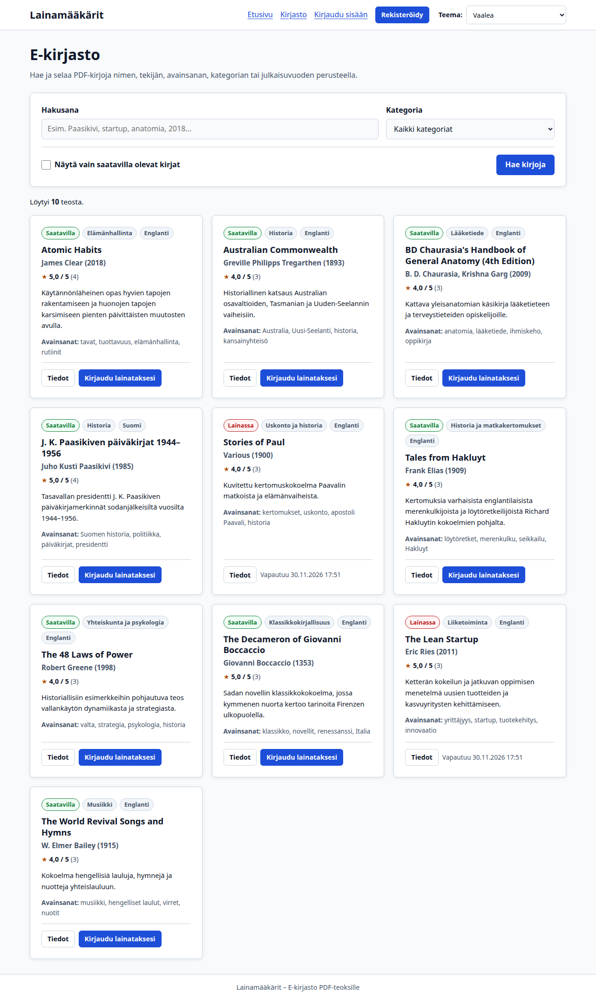

#### Tumma teema (`dark`)

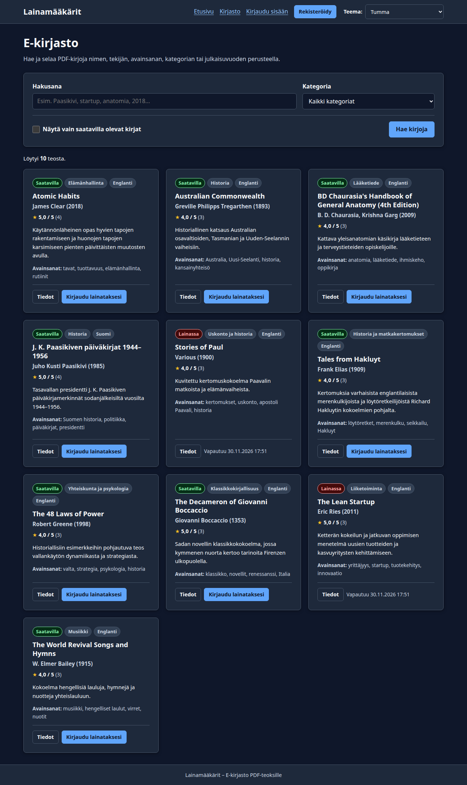

#### Korkea kontrasti – vaalea (`high-light`)

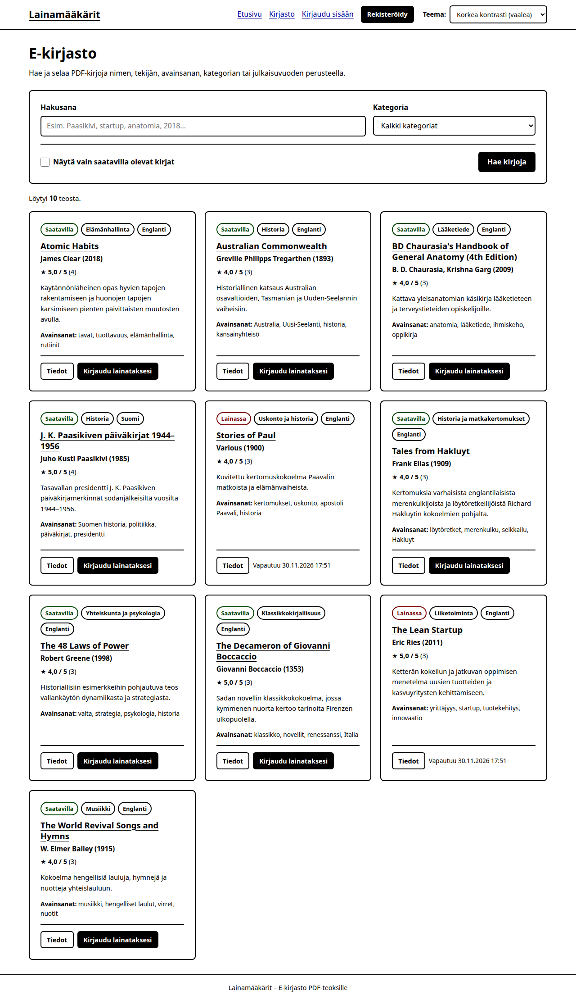

#### Korkea kontrasti – tumma (`high-dark`)

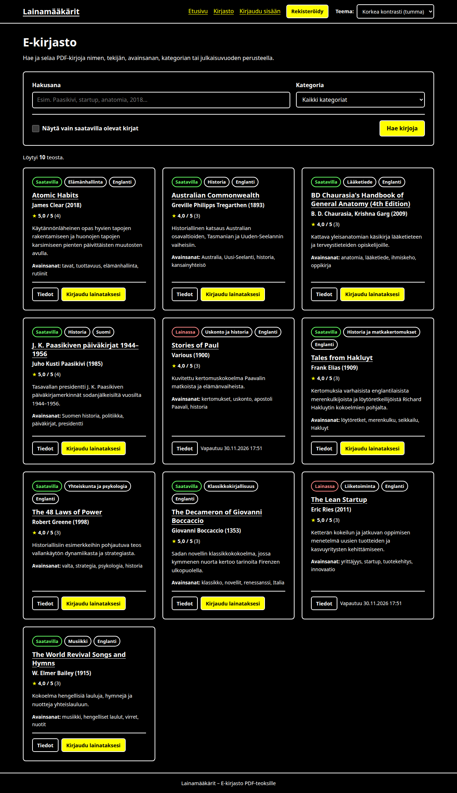

---

### Kirjan lainaussivu, arvostelut ja tähtiarvosanat

Kirjan sivulla käyttäjä näkee teoksen tiedot, tähtiarvosanojen mediaanin ja keskiarvon, lainauspainikkeen (tai voimassa olevan lainan väliaikaisen PDF-avaus-/latauslinkin ja palautuspainikkeen) sekä arvostelulomakkeen (1–5 tähteä).

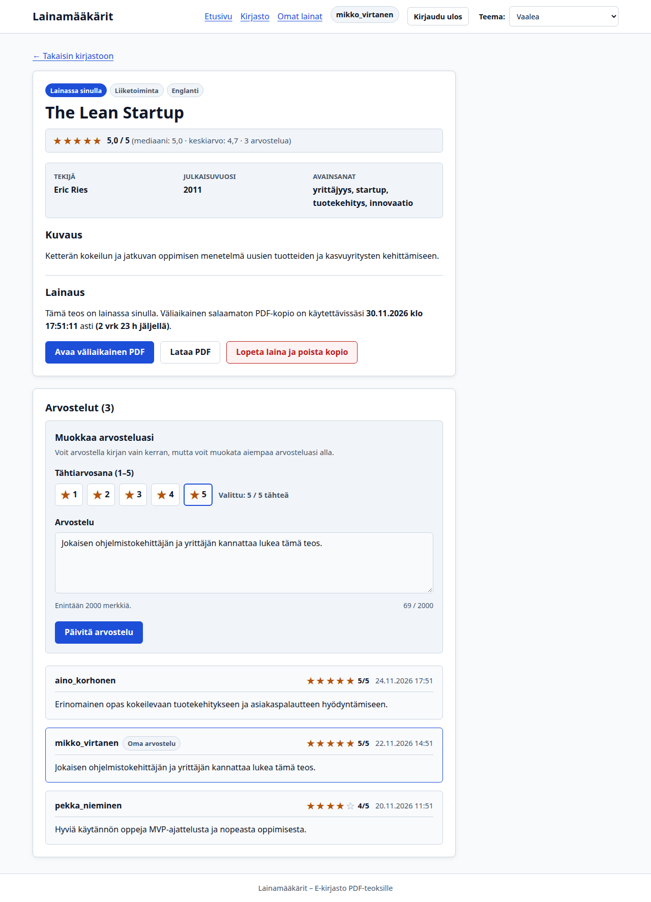

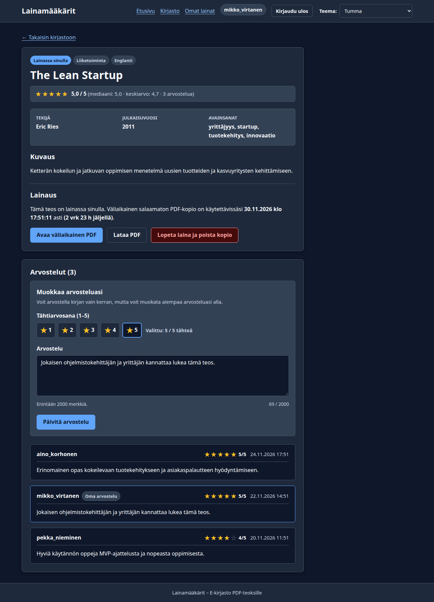

#### Omat lainat

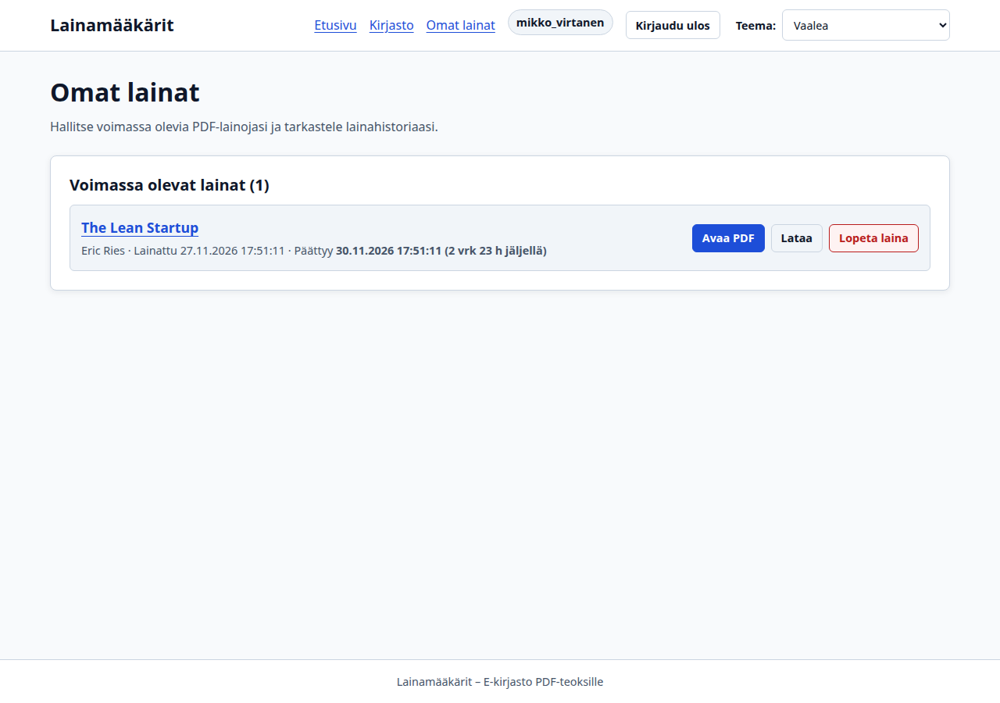

---

### Mobiilinäkymät

Sivusto toimii kapeilla mobiilinäytöillä ilman vaakasuuntaista vieritystä ja sisältää avattavan mobiilivalikon.

| Kirjasto mobiilissa (vaalea, valikko auki) | Kirjasivu mobiilissa (korkea kontrasti tumma) |
| :---: | :---: |
| 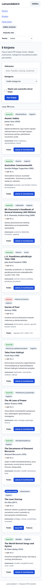 | 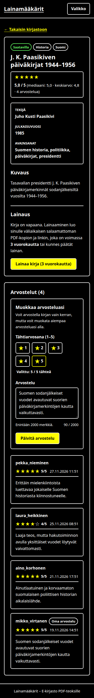 |

---

### Huolto – Ylläpitopaneeli

Ylläpitäjille näkyvä **Huolto**-sivu kokoaa yhteen voimassa olevien lainojen muokkauksen ja pikapäättämisen, uusien kommenttien syötteen päivämääräsuodattimella ja poistotoiminnolla sekä kirjojen valikoimasta piilottamisen ja palauttamisen.

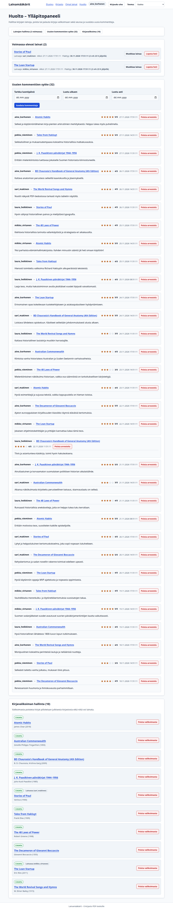

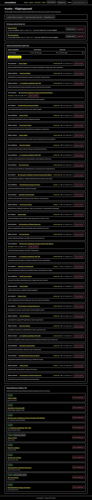

---

## Testaus

Suorita kattava yksikkö- ja lomaketestisarja (sisältää suomen-, kiinan- ja arabiankieliset syötteet sekä XSS-, SQLi- ja polunylitystestit):

```bash
.venv/bin/python manage.py test -v 2
```

Päivitä pitkät Playwright-kuvakaappaukset ja suorita automaattinen responsiivisuus- ja kontrastitarkistus eri näyttöko'oilla:

```bash
.venv/bin/python scripts/capture_screenshots.py
```
